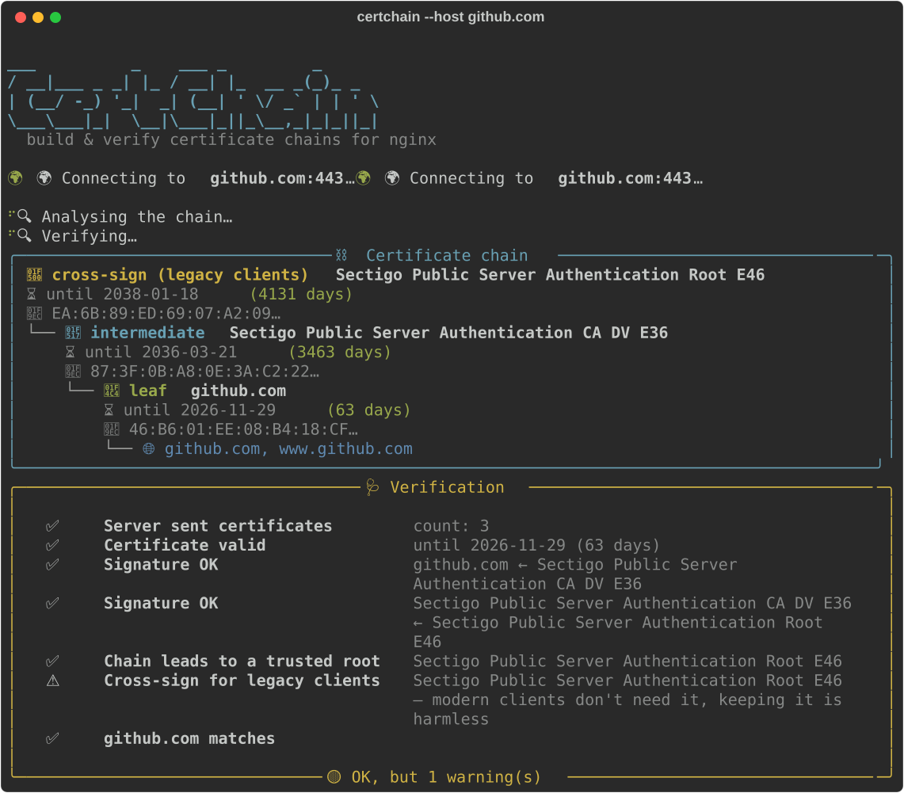

# 🔐 certchain

[](https://github.com/mpasternak/certchain/actions/workflows/ci.yml)
[](https://www.python.org/)
[](LICENSE)

**Build a correct `fullchain` for nginx from whatever your CA sent you — and verify it before it hits production.**



## Why?

Your CA sends a certificate, an intermediate (sometimes two, sometimes a bundle with a root in it,
sometimes as `.p7b`), and you have a private key. nginx wants **one file**: leaf first, then
intermediates, no root, newline between blocks. Get it wrong and you get:

- `key values mismatch` — files concatenated in the wrong order,
- `PEM_read_bio_X509` errors — `-----END CERTIFICATE----------BEGIN CERTIFICATE-----` glued together,
- a site that works in Chrome (which quietly fetches missing intermediates) but fails in `curl`,
  Java, Python `requests`, older Android and every webhook caller.

`certchain` puts the pieces together correctly and tells you exactly what's wrong if they don't fit.

## Features

- 🔮 **Guesses the files** in the current directory: `*cert*` / `*certificate*` / `*crt*` for the
  certificate, `*key*` for the key (the one that actually matches wins), and whatever really
  signed your certificate as the intermediate.
- ⛓️ **Orders the chain** by verifying signatures — input order doesn't matter; drops duplicates,
  unrelated certificates and the unnecessary root.
- 🌐 **Fetches missing intermediates** from the certificate's AIA `caIssuers` URL. A fetched
  certificate is only accepted if it cryptographically signed yours.
- 🩺 **Verifies**: signatures, trust up to a root in the Mozilla store (via
  [certifi](https://pypi.org/project/certifi/)), expiry dates, private key ↔ certificate match
  (RSA/EC), hostname against SAN (with correct wildcard rules).
- 🔀 **Understands cross-signs** — chains like Certum or Sectigo that append legacy cross-signed
  roots are reported as OK (with an optional trim), not as "broken".
- 🌍 **Checks live servers** (`--host`): shows what a server actually sends and whether it is
  missing an intermediate.
- 📦 Reads **PEM, DER and PKCS#7** (`.p7b`/`.p7c`); handles encrypted keys (asks for the passphrase).
- 🧩 Prints the matching `ssl_certificate` / `ssl_certificate_key` lines for nginx.

## Installation

Requires Python **3.13+** and [uv](https://docs.astral.sh/uv/).

Run it without installing anything:

```bash
uv run https://raw.githubusercontent.com/mpasternak/certchain/main/certchain.py
```

Install as a command:

```bash
uv tool install git+https://github.com/mpasternak/certchain
certchain --help
```

Or just download `certchain.py` — it is a single self-contained script with
[inline dependencies](https://peps.python.org/pep-0723/), so `./certchain.py` works anywhere `uv` is installed.

## Usage

```bash
# interactive: guesses files in the current directory, asks about the rest
certchain

# fully automatic in the current directory (use guesses, fetch via AIA, overwrite)
certchain -y

# explicit
certchain -c cert.crt -i intermediate.crt -k private.key -o fullchain.crt -n www.example.com

# only verify an existing file
certchain --check fullchain.crt -k private.key

# what does a live server send? (-o saves a repaired chain)
certchain --host example.com
certchain --host example.com:8443 -o fullchain.crt
```

| Option | Meaning |
|---|---|
| `-c, --cert` | leaf certificate |
| `-i, --intermediate` | intermediate certificate(s), repeatable; bundles are fine |
| `-k, --key` | private key, to check that it matches |
| `-o, --output` | output file (default `fullchain.crt`) |
| `-n, --hostname` | check that the certificate covers this domain |
| `--check FILE` | verify an existing fullchain only |
| `--host HOST[:PORT]` | verify the chain a live server sends |
| `-y, --yes` | never ask: use guessed files, overwrite without confirmation |
| `--no-fetch` | never download intermediates via AIA |

Exit codes: `0` everything OK (warnings allowed), `1` verification errors, `2` bad input or connection failure.

## Notes

- **Trust store**: trust is checked against Mozilla's root store as shipped by `certifi`, not your
  OS store. Private/corporate CAs will show up as "UNKNOWN root".
- **`--host` disables TLS verification on purpose** — the point is to see what a possibly broken
  server sends. Nothing is transmitted over that connection; all checks happen afterwards.
- **AIA downloads usually use plain HTTP.** That's by design of AIA and safe here: a downloaded
  certificate is rejected unless its signature over your certificate verifies.
- Other servers: the output (leaf + intermediates, PEM) is also what HAProxy (plus the key),
  Apache ≥ 2.4.8 `SSLCertificateFile`, Traefik, Caddy and Postfix expect.

## Development

```bash
uv run pytest
uv run ruff check . && uv run ruff format --check .
pre-commit install   # optional
```

Tests build their own throwaway PKI in memory — no network, no real certificates.

## License

[MIT](LICENSE) © Michał Pasternak
